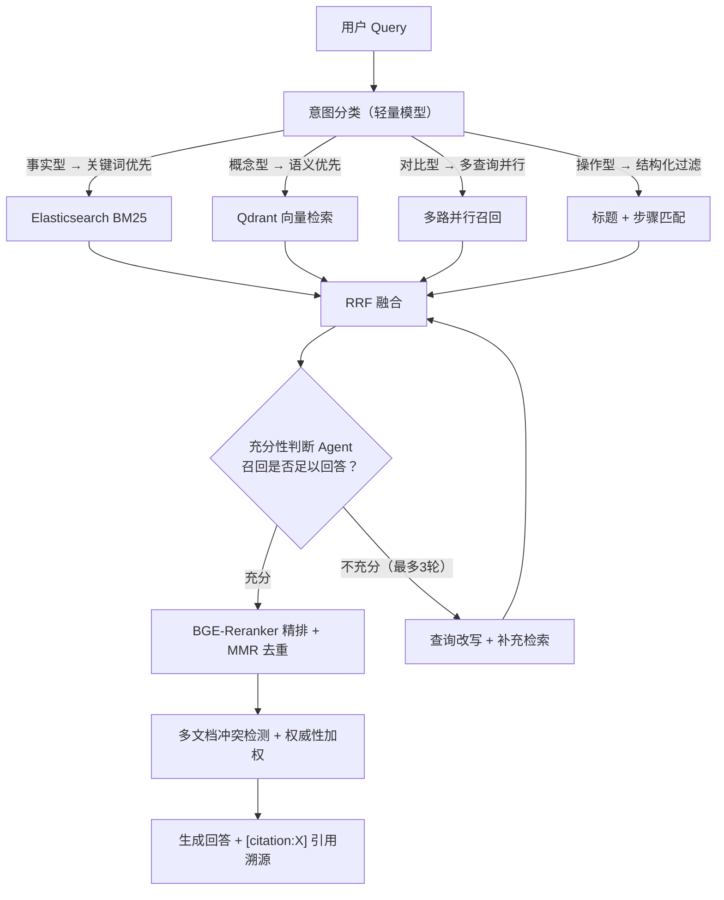

# Agentic RAG — 企业多源异构文档智能问答平台

面向企业内部跨平台（Confluence/语雀/Google Docs）、多格式（PDF/Word/PPT/Excel/图片/Markdown）文档的统一知识问答系统。基于 **Agentic RAG** 范式，由 LLM 在检索阶段实时判断检索结果是否充分、动态调整检索策略，替代传统 RAG 的固定线性管道。

## 技术栈

| 层级 | 选型 | 说明 |
|------|------|------|
| Web框架 | FastAPI | 异步高性能，自动生成 OpenAPI 文档 |
| Agent编排 | LangGraph | 有状态检索决策回路（意图分类→召回→充分性判断→改写循环） |
| 向量数据库 | Qdrant | 单机高性能，gRPC 接口 |
| 关键词检索引擎 | Elasticsearch | 工业级 BM25 全文检索 |
| 缓存 | Redis | 多级缓存：精确匹配 / 归一化查询（权限组 + 索引版本隔离） |
| Embedding | BGE-M3 (本地) | 1024维，同时输出稠密+稀疏向量 |
| Reranker | BGE-Reranker-v2-m3 (本地) | Cross-Encoder 精排 + MMR 去重 |
| LLM | OpenAI API (可替换) | 生成用大模型 + 意图分类用轻量模型（降本） |
| 文档解析 | MinerU / PyMuPDF / PaddleOCR / python-docx / python-pptx / openpyxl | 按版面复杂度与文件类型智能路由 |
| 分块策略 | Small-to-Big | 子块 256 token 精确检索 / 父块 1024 token 回溯上下文 |
| 表格索引 | 行级 + 表级双索引 | 行级定位 + LLM 语义摘要整体理解 |
| 评估框架 | RAGAS | 6 维度自动评估 |
| 在线监控 | Prometheus + Grafana | 点踩率 / 延迟 / 查询量看板 |
| 管理控制台 | Streamlit | 文档管理 / 检索测试 / 系统监控 |

## 快速开始

### 一键启动（推荐）

```bash
# 1. 配置
cp .env.example .env
# 编辑 .env，填入 OPENAI_API_KEY（不填也能启动，LLM 相关功能降级为规则）

# 2. 一键启动全套（Qdrant + ES + Redis + API + Streamlit + Prometheus + Grafana）
cd deployments
docker compose up -d --build
```

启动后访问：

| 服务 | 地址 | 说明 |
|------|------|------|
| API 文档 | http://localhost:8000/api/v1/docs | Swagger UI |
| 管理控制台 | http://localhost:8501 | Streamlit |
| Prometheus | http://localhost:9090 | 指标采集 |
| Grafana | http://localhost:3000 | 在线监控看板（匿名登录，已预置 RAG 看板） |

### 本地开发（不用 Docker 跑基础设施）

```bash
pip install -r requirements.txt
cd deployments && docker compose up -d qdrant elasticsearch redis
uvicorn src.api.main:app --host 0.0.0.0 --port 8000
streamlit run frontend/app.py
```

## 项目结构

```
enterprise-rag-platform/
├── src/
│   ├── api/                # FastAPI 路由
│   │   ├── main.py         #   应用入口 + /metrics
│   │   ├── documents.py    #   文档上传/解析/双路索引（增量去重+权限）
│   │   ├── search.py       #   检索/问答/反馈回流
│   │   └── system.py       #   健康检查/统计/链路追踪
│   ├── core/               # 配置 + SQLite元数据 + LLM工厂 + Prometheus指标
│   ├── document_pipeline/  # 文档解析路由：PDF/Word/PPT/Excel/图片/Markdown
│   ├── chunking/           # Small-to-Big 分块 + 表格行级/表级双索引
│   └── retrieval/          # Agentic RAG 检索引擎（LangGraph 编排）
│       ├── agentic.py      #   状态图：分类→召回→充分性判断→改写→冲突消解
│       ├── intent.py       #   轻量意图分类器（规则兜底）
│       ├── retrievers.py   #   Qdrant + Elasticsearch 双路召回
│       ├── fusion.py       #   RRF 融合 + 去重
│       ├── reranker.py     #   BGE-Reranker 精排 + MMR
│       ├── conflict.py     #   冲突检测 + 权威性加权
│       └── cache.py        #   Redis 多级缓存
├── configs/                # YAML 策略配置 + Prompt 模板
├── eval/                   # 600 条黄金测试集 + 评估 harness
├── frontend/               # Streamlit 管理控制台
├── deployments/            # Docker Compose + Prometheus + Grafana
├── scripts/                # 批量导入 / 压测 / RAGAS demo
└── requirements.txt
```

## 核心架构



### 1. Agentic RAG 自适应检索（LangGraph 状态图）

传统 RAG 所有查询走同一条固定管道；本系统用 LangGraph 构建有状态决策回路，LLM 在检索阶段实时决策：

1. **意图分类 + 路由**：轻量模型（默认 `gpt-4o-mini`）分类，事实型→关键词优先、概念型→语义优先、对比型→多查询并行、操作型→结构化过滤；无 LLM 时规则兜底
2. **多路召回**：Qdrant（向量）+ ES（BM25），RRF 融合（尺度无关，解决 BM25 与 cosine 分数不可直接比较的问题）
3. **充分性判断**：LLM 对 Top-10 打分，`>0.8` 充分进入生成、`<0.5` 触发补充检索
4. **查询改写**（最多 3 轮）：同义词替换 → 实体追加 → 引用线索追踪；新增文档净增量 `<20%` 提前终止
5. **冲突检测 + 权威性加权** → **精排 + 生成**

### 2. 多格式文档解析

| 文件类型 | 解析器 | 说明 |
|----------|--------|------|
| PDF (文本) | PyMuPDF | 提取文本 + 表格 |
| PDF (复杂版面) | MinerU | 多栏/公式/复杂表格；CLI 子进程调用，失败回退 PyMuPDF |
| PDF (扫描件) | PaddleOCR | 中文 OCR（可选依赖） |
| Word | python-docx | 保留标题层级 |
| PPT | python-pptx | Slide 级解析 + 备注提取 |
| Excel | openpyxl | 多 Sheet → Markdown 表格 |
| Markdown | 原格式 + 表格提取 | 保留层级，提取 `|a|b|` 表格 |

> 路由规则：按扩展名分发；PDF 先扫描页级文本密度与版面特征，扫描页走 OCR，多栏/多表/矢量密集页整篇交给 MinerU，其余走 PyMuPDF 快速通道。重型解析器未安装时自动降级，不影响主链路。

### 3. Small-to-Big 分块 + 表格双索引

- **子块 256 token**：精确检索；**父块 1024 token**：命中子块后回溯父块完整上下文生成
- **行级索引**：每行 = 独立检索单元（携带表头上下文），精确定位"某区域 Q3 数据"
- **表级索引**：LLM 生成语义摘要作为独立向量点，回答"季度销售趋势"这类整体理解问题

### 4. 多文档冲突消解 + 可信度建模

三阶段：**LLM 冲突检测** → **信源权威性自动加权**（版本新旧 / 部门层级 / 更新时间 / 反馈可信度，真实计算而非 Prompt 空话）→ **多方呈现 + 推荐结论**。用户点踩/点赞经 `/feedback` 回流，按指数滑动平均（α=0.9）修正文档可信度权重并写入 `feedback_log` 审计，形成可迭代模型。

### 5. 权限过滤 + 增量索引与删除传播

- **权限过滤**：文档标记 `permission_groups`，检索时按用户所属权限组过滤（Qdrant/ES 双重过滤）；缓存 key 同样包含权限组，避免跨权限命中
- **增量索引更新**：上传按 SHA-256 checksum 去重；`PUT /documents/{id}` 先清理旧索引再重建，内容未变化时跳过
- **删除传播**：删除文档时同步清理 Qdrant（按 `doc_id` 过滤删除）与 ES（`delete_by_query`）；失败写入 `index_sync_tasks` 补偿表，由 `POST /system/reconcile` 重试，`rag_index_sync_pending` 指标暴露积压

### 6. 离线评估 + 在线监控

- **离线**：600 条分层测试集（Easy:Medium:Hard = 4:4:2；table / conflict / general 子集），检索指标（Recall@K/MRR/冗余）+ 答案完整度（要点覆盖率）+ RAGAS 6 维度（忠实度/相关性/上下文精度/召回/噪音敏感/正确性），支持基线 vs Agentic 对比与 badcase 归因（解析/召回/重排/生成）
- **在线**：Prometheus 采集点踩率/延迟/查询量，Grafana 看板实时展示，并配置点踩率、P95 延迟与补偿任务积压的阈值告警

## API 接口

| 方法 | 路径 | 说明 |
|------|------|------|
| POST | `/api/v1/documents/upload` | 上传文档（自动解析→双索引分块→Qdrant+ES） |
| GET | `/api/v1/documents/` | 文档列表 |
| DELETE | `/api/v1/documents/{id}` | 删除文档（同步清理 Qdrant/ES，失败补偿） |
| PUT | `/api/v1/documents/{id}` | 更新文档（清理旧索引→重建） |
| POST | `/api/v1/search/search` | 纯检索（含检索链路追踪） |
| POST | `/api/v1/search/answer` | 检索 + LLM 生成（含引用溯源） |
| POST | `/api/v1/search/feedback` | 用户反馈（回流修正可信度） |
| GET | `/api/v1/system/stats` | 统计概览（含待补偿索引任务数） |
| POST | `/api/v1/system/reconcile` | 重试索引删除补偿任务 |
| GET | `/api/v1/system/trace/{request_id}` | 单次请求链路追踪 |
| GET | `/metrics` | Prometheus 指标 |

## 评估

```bash
# 生成/刷新 600 条黄金测试集（固定种子，可复现）
python eval/generate_golden_set.py

# 检索指标 + 分类子集 + badcase 归因（无需 LLM）
python eval/run_eval.py --mode retrieval

# 小样本快速验证
python eval/run_eval.py --mode retrieval --sample 50

# 追加答案完整度（要点覆盖率）与 RAGAS 6 维度（需 OPENAI_API_KEY）
python eval/run_eval.py --mode full

# RAGAS 最小 demo
python scripts/ragas_demo.py
```

> 黄金集由 20 篇种子文档模板化生成（600 条，Easy/Medium/Hard=4:4:2，含 table/conflict/general 子集），用于流程验证与回归；接入真实知识库后可按同一 schema 替换为真实问题集。完整度口径为"要点覆盖率"（字符二元组匹配，非 LLM judge）；结果写入 `eval/results/{mode}_{timestamp}.json`。

## 测试

```bash
pip install -r requirements-dev.txt
python -m pytest tests/ -v
```

55 个用例覆盖解析路由/分块/融合/冲突/意图/缓存/删除传播/数据库/API，全部可在无 Qdrant/ES/Redis/LLM 的环境下离线运行（外部依赖自动降级，缺少可选依赖时个别用例自动跳过）。

## 认证与权限

- 默认 `AUTH_ENABLED=false`（本地开发开放模式）
- 生产置 `AUTH_ENABLED=true`，配置 `API_KEYS={"key":"权限组，逗号分隔"}`（`"*"`=全员）
- 请求携带 `X-API-Key` 头，服务端从 key 解析用户权限组并**前置过滤**到 Qdrant/ES 检索层，不信任客户端请求体
