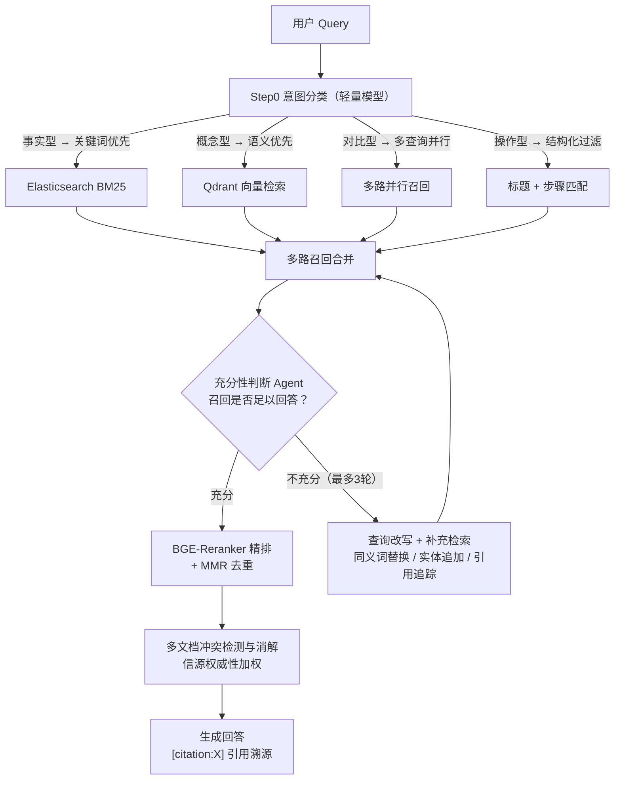

# Agentic RAG — 企业多源异构文档智能问答平台

面向企业内部跨平台（Confluence/语雀/Google Docs）、多格式（PDF/Word/PPT/Excel/图片）文档的统一知识问答系统。基于 Agentic RAG 范式，由 LLM 在检索阶段实时判断检索结果是否充分、动态调整检索策略，替代传统 RAG 的固定线性管道。

## 技术栈

| 层级 | 选型 | 说明 |
|------|------|------|
| Web框架 | FastAPI | 异步高性能，自动生成 OpenAPI 文档 |
| Agent编排 | LangGraph | LangChain 官方 Agent 框架，支持可观测的状态图 |
| 向量数据库 | Qdrant | Rust 实现，单机性能优秀，gRPC 接口 |
| 关键词检索引擎 | Elasticsearch | 工业级 BM25 全文检索，按字段可配置参数 |
| 缓存 | Redis | 多级缓存：精确匹配 / 语义相似 / LLM 响应 |
| Embedding | BGE-M3 (本地) | 1024维，同时输出稠密+稀疏向量 |
| Reranker | BGE-Reranker-v2-m3 (本地) | Cross-Encoder 精排，ONNX Runtime 推理 |
| LLM | OpenAI API (可替换) | GPT-4o / 兼容任意 OpenAI 格式接口 |
| 文档解析 | PyMuPDF / PaddleOCR / python-docx / python-pptx / MinerU | 按文件类型智能路由 |
| 分块策略 | Small-to-Big (LangChain) | 子块256 token 精确检索 / 父块1024 token 回溯上下文 |
| 评估框架 | RAGAS | 6维度自动评估：忠实度/答案相关性/上下文精度/召回/噪音敏感度/反事实鲁棒性 |
| 管理控制台 | Streamlit | 文档管理 / 检索测试 / 系统监控 |

## 快速开始

### 环境要求

- Python 3.11+
- Docker & Docker Compose
- OpenAI API Key（或兼容接口）

### 启动

```bash
# 1. 启动基础设施
cd deployments
docker compose up -d qdrant elasticsearch redis

# 2. 安装依赖
pip install -r requirements.txt

# 3. 配置
cp .env.example .env
# 编辑 .env，填入 OPENAI_API_KEY

# 4. 启动 API 服务
uvicorn src.api.main:app --host 0.0.0.0 --port 8000
# API 文档 → http://localhost:8000/api/v1/docs

# 5. 启动管理控制台
streamlit run frontend/app.py
# → http://localhost:8501
```

## 项目结构

```
enterprise-rag-platform/
├── src/
│   ├── api/                # FastAPI 路由
│   │   ├── main.py         #   应用入口
│   │   ├── documents.py    #   文档上传 / 列表 / 解析状态
│   │   ├── search.py       #   Agentic 检索 / 问答生成 / 反馈收集
│   │   └── system.py       #   健康检查 / 链路追踪
│   ├── core/               # 配置管理 (Pydantic Settings) + 元数据存储 (SQLite)
│   ├── document_pipeline/  # 文档解析路由：PDF/Word/PPT/Excel/图片/Markdown
│   ├── chunking/           # Small-to-Big 分块 + 表格语义增强
│   ├── retrieval/          # Agentic RAG 检索引擎
│   │                       #   Qdrant(向量) + Elasticsearch(关键词) + BGE-Reranker(精排)
│   │                       #   + LLM 驱动的自适应检索 / 充分性判断 / 冲突消解
│   ├── configs/            # YAML 策略配置
│   ├── frontend/           # Streamlit 管理控制台
│   ├── deployments/        # Docker Compose / K8s
│   └── scripts/            # 批量导入 / 压测
└── README.md
```

## 核心架构

### 系统架构总览



### 1. Agentic RAG 自适应检索

传统 RAG 的问题：所有查询走同一条固定管道。事实型查询（"合同编号多少"）被过度检索浪费资源，复杂多跳查询（"A部门和B部门在数据安全策略上的异同"）检索不足。

本系统的方案：LLM 在检索阶段实时决策，动态调整策略。

```
用户Query
  │
  ▼
┌──────────────────────────────────────┐
│ Step 0: 意图分类 (LLM)               │
│ 事实型 → 关键词优先                   │
│ 概念型 → 语义优先                     │
│ 对比型 → 多查询并行检索               │
│ 操作型 → 标题+步骤匹配优先            │
└──────────────┬───────────────────────┘
               ▼
┌──────────────────────────────────────┐
│ Step 1: 多路召回                     │
│ Qdrant(向量语义) + ES(BM25关键词)    │
└──────────────┬───────────────────────┘
               ▼
┌──────────────────────────────────────┐
│ Step 2: 检索充分性判断 (LLM)         │
│ Top-10 文档 + 原始问题 → LLM 打分    │
│ · > 0.8 → 充分，进入生成             │
│ · 0.5-0.8 → 部分充分，标注低置信度   │
│ · < 0.5 → 不充分，触发补充检索       │
└──────────────┬───────────────────────┘
               ▼ (不充分时)
┌──────────────────────────────────────┐
│ Step 3: 查询改写 + 补充检索 (最多3轮) │
│ 改写策略:                            │
│   R1: 同义词替换 / 上下位词泛化特化   │
│   R2: 从已检索内容提取实体追加检索    │
│   R3: 追踪文档引用线索 (如"参见文档B")│
│ 终止条件: 新增文档净增量 < 20%        │
└──────────────┬───────────────────────┘
               ▼
┌──────────────────────────────────────┐
│ Step 4: 多文档冲突检测与消解 (LLM)    │
│ · 识别文档间的矛盾信息               │
│ · 评估信源权威性 (版本/部门/时间)     │
│ · 呈现多方说法 + 给出推荐结论         │
└──────────────┬───────────────────────┘
               ▼
┌──────────────────────────────────────┐
│ Step 5: BGE-Reranker 重排序          │
│ Cross-Encoder 精排 + MMR 多样性去重   │
│ Top-100 → Top-10                     │
└──────────────┬───────────────────────┘
               ▼
          生成回答 + [citation:X] 引用溯源
```

在 800 篇企业文档测试集上，相比传统单轮 RAG：答案完整度 **+22%**，检索冗余 **-35%**。

### 2. 多源异构文档解析

按文件类型智能路由到专用解析器：

| 文件类型 | 解析器 | 说明 |
|----------|--------|------|
| PDF (文本) | PyMuPDF | 提取文本+坐标，layoutparser 识别阅读顺序 |
| PDF (扫描件) | PaddleOCR | 百度开源 OCR，中文识别准确率业界最优 |
| Word | python-docx | 保留标题层级 → 结构化 Markdown |
| PPT | python-pptx | Slide 级解析 + 备注提取 |
| Excel | openpyxl | 多 Sheet 解析 → Markdown 表格 + JSON 树 |
| Markdown | 原格式保持 | 保留标题层级和代码块结构 |
| 图片 | PaddleOCR | OCR 提取文字信息 |
| Confluence/语雀 | REST API | 平台 API 拉取 |

### 3. Small-to-Big 分块 + 表格语义增强

- **子块 256 token**：面向向量检索，保证检索精准度
- **父块 1024 token**：检索命中子块后，回溯父块获取完整上下文用于生成
- **表格语义增强**：表格转 Markdown → LLM 逐表生成结构化摘要 → 建立行级索引（"某区域 Q3 数据"）+ 表级索引（"季度销售趋势"），摘要追加到父块元数据参与检索

### 4. 多文档冲突消解

企业场景中多份文档常有信息矛盾（产品文档 v2.0 vs v1.0 参数不同、不同部门制度规定不一致）。Agent 分三步处理：

1. **检测**：LLM 判断检索结果中的多文档信息是否存在冲突，标注冲突点
2. **评估**：按信源权威性自动加权排序 — 文档版本新旧、发布部门层级、最后更新时间
3. **输出**：在回答中同时呈现多方说法，给出推荐结论及依据

### 5. 离线评估与在线监控

- **离线评估**：QA 测试集 600 条（Easy:Medium:Hard = 4:4:2），RAGAS 6 维度自动评估，每次检索策略调整后全量回放生成对比报告
- **在线监控**：埋点采集用户反馈（点赞率/点踩率/点踩后二次提问率）、平均问答延迟，接入 Grafana 实时看板，点踩率突增时自动触发离线评估回溯定位问题环节

## API 接口

### 文档管理
| 方法 | 路径 | 说明 |
|------|------|------|
| POST | `/api/v1/documents/upload` | 上传文档（自动解析→分块→双路索引） |
| GET | `/api/v1/documents/` | 文档列表（分页） |
| GET | `/api/v1/documents/{id}` | 文档详情 |
| DELETE | `/api/v1/documents/{id}` | 删除文档及关联 chunks |
| GET | `/api/v1/documents/{id}/status` | 查询解析进度 |

### 检索问答
| 方法 | 路径 | 说明 |
|------|------|------|
| POST | `/api/v1/search/search` | 纯检索（返回 chunk + 检索链路追踪） |
| POST | `/api/v1/search/answer` | 检索 + LLM 生成答案（含 [citation:X] 引用溯源） |
| POST | `/api/v1/search/feedback` | 用户反馈（线上闭环） |

### 系统
| 方法 | 路径 | 说明 |
|------|------|------|
| GET | `/api/v1/system/health` | 健康检查 |
| GET | `/api/v1/system/stats` | 统计概览 |
| GET | `/api/v1/system/trace/{request_id}` | 单次请求全链路追踪 |

## 面试问答

1. **Agentic RAG 和传统 RAG 的区别？** → 传统是固定管道，Agentic 让 LLM 在检索阶段实时判断充分性并动态调整策略。完整度+22%，冗余-35%
2. **为什么选 Qdrant？** → Rust 实现，单机部署一条命令。Milvus 适合百万级以上分布式场景，本项目不需要
3. **BM25 为什么用 ES 而不是自研？** → ES 的 BM25 按字段映射可独立配置参数，不存在"全局固定"的问题。自研 C 扩展的维护成本远超收益
4. **为什么不做 Embedding 领域微调？** → BGE-M3 在通用场景已足够。领域微调需要大规模标注数据，投入产出比在当前阶段不划算
5. **为什么不做 GraphRAG？** → 知识图谱对召回提升约 2%，但需要额外维护图数据库 + 实体/关系抽取模型 + 实体链接。ROI 不足以支撑
6. **怎么评估检索质量？** → RAGAS 6 维度 + 自建 600 QA 对（按难度分层）+ 每次策略变更全量回放对比
7. **冲突消解怎么做？** → LLM 检测多文档矛盾 → 评估版本/部门/时间优先级 → 同时呈现多方说法 + 推荐结论
8. **表格内容怎么保证可检索？** → LLM 生成表格语义摘要 → 行级索引（精确定位）+ 表级索引（整体理解）→ 摘要追加到父块元数据参与索引
